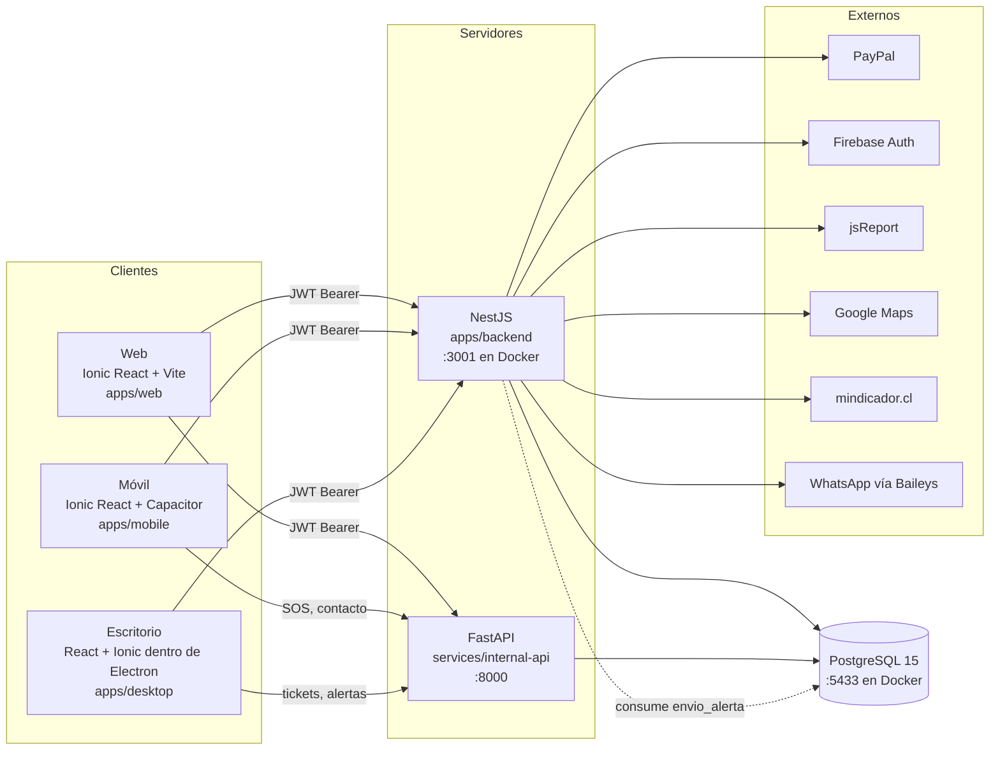
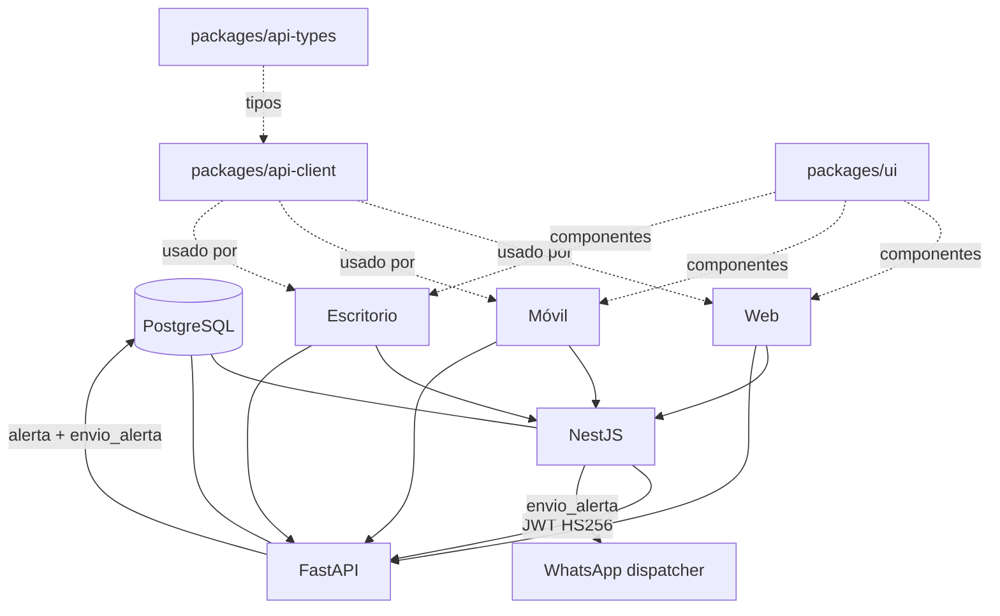

# Arquitectura de EMERGEN

Escrito para: estudiante que debe explicar la arquitectura ante una comisión.

## 1. Visión general

EMERGEN es una plataforma de alertas de emergencia (SOS) con tres interfaces de usuario, un backend principal y un servicio de apoyo. Todo está en un monorepo con **npm workspaces** y **Turborepo** (`package.json`, `turbo.json`).



## 2. Respuestas a las preguntas de la Etapa 1

**¿Cómo está construido?** Tres interfaces de usuario que consumen dos APIs HTTP. NestJS es la API principal: cuentas, sesiones, perfiles, planes, compras, administración e integraciones. FastAPI es un servicio pequeño que registra SOS, cierres y tickets. Ambos leen la misma base PostgreSQL. No hay colas externas ni bus de mensajes: la "cola" de envíos de WhatsApp es una tabla (`envio_alerta`).

**¿Qué tecnologías usa?** (verificado en `package.json` y `requirements.txt` de cada paquete)

| Capa | Tecnología | Evidencia |
|---|---|---|
| Frontends | React, Ionic React, react-router-dom, axios | `apps/*/package.json` |
| Móvil nativo | Capacitor (Android) | `apps/mobile/package.json` (`@capacitor/android`) |
| Escritorio | Electron + React | `apps/desktop/electron/main.cjs`, `apps/desktop/package.json` |
| Build | Vite | `apps/desktop/vite.config.ts`, scripts `dev`/`build` |
| Backend principal | NestJS 12 (`@nestjs/core` 12.0.4) con TypeORM y `pg` | `apps/backend/package.json` |
| Autenticación | JWT HS256 (`@nestjs/jwt`, `jsonwebtoken`), bcrypt, Firebase | `apps/backend/src/login/login.module.ts` |
| Validación | class-validator, `ValidationPipe` global | `apps/backend/src/main.ts:28-34` |
| WhatsApp | Baileys (no es API oficial) | `apps/backend/package.json`, README §5 |
| Servicio SOS | FastAPI, psycopg, PyJWT | `services/internal-api/app/`, `requirements.txt` |
| Base de datos | PostgreSQL 15-alpine | `docker-compose.yml`, `README_BDD.md` |
| Monorepo | npm workspaces + Turborepo | `package.json`, `turbo.json` |
| Contenedores | Docker Compose | `docker-compose.yml`, `docker-compose.production.yml` |

**¿Por qué pudo elegirse cada tecnología?** Este es un análisis, no una decisión documentada. No hay actas que expliquen la elección.

- **React + Ionic + Capacitor:** una sola base de código para web y Android. Ionic da componentes móviles y Capacitor da acceso al hardware (geolocalización, háptica) para el SOS.
- **Electron:** el panel administrativo necesita una aplicación de escritorio. Electron reutiliza React y permite compartir código con la web.
- **NestJS:** módulos, inyección de dependencias, guards y pipes declarativos. Facilita separar cuentas, compras y administración en carpetas independientes.
- **FastAPI:** un servicio separado para SOS y tickets. Se puede escalar o reemplazar sin tocar NestJS. Su validación con Pydantic y su documentación OpenAPI automática también ayudan.
- **PostgreSQL:** soporta transacciones, bloqueos de fila (`FOR UPDATE`, `SKIP LOCKED`), restricciones y JSON. Es necesario para los cupos y la concurrencia de SOS.
- **Docker:** un solo comando levanta base de datos, NestJS y FastAPI con las mismas versiones.

**¿Cómo se comunican las aplicaciones?**

1. Los frontends llaman a NestJS con `Authorization: Bearer <JWT>`. El cliente compartido está en `packages/api-client/src/emergen-api.ts` y `http.ts`.
2. Los frontends llaman a FastAPI con el mismo JWT. FastAPI lo verifica con el mismo secreto (`JWT_SECRET`), con `issuer` y `audience` iguales, y releé el usuario en la base en cada petición (`services/internal-api/app/dependencies/auth.py`).
3. Ambos servicios hablan con PostgreSQL. NestJS usa TypeORM y consultas SQL crudas; FastAPI usa `psycopg` con SQL escrito a mano. El esquema lo define `init.sql` y TypeORM tiene `synchronize: false` (README_BDD).
4. NestJS procesa el envío de WhatsApp leyendo la tabla `envio_alerta`, que FastAPI llena dentro de la misma transacción del SOS (`apps/backend/src/integrations/whatsapp/whatsapp-sos-dispatcher.service.ts:47`, `:84-101`).

**¿Dónde comienza la ejecución?**

| Parte | Punto de entrada | Qué hace |
|---|---|---|
| NestJS | `apps/backend/src/main.ts:12` (`bootstrap`) | Crea la app, configura CORS, timeouts, `ValidationPipe` global y escucha en el puerto |
| FastAPI | `services/internal-api/app/main.py` | Crea `FastAPI`, middleware de límite de cuerpo (16 KB), CORS, rutas y `/health` |
| Web | `apps/web/src/main.tsx` | `createRoot` con `BrowserRouter` y `App` |
| Móvil | `apps/mobile/src/main.tsx` | Igual que la web, con las rutas de `App.tsx` |
| Escritorio | `apps/desktop/electron/main.cjs` (proceso principal) y `apps/desktop/src/main.tsx` | Electron abre la ventana y React muestra el panel |

**¿Cómo se procesan las solicitudes?**

NestJS (`apps/backend/src/main.ts`):
1. `configureHttpBoundary` (CORS antes del parser de cuerpo).
2. `ValidationPipe` global con `whitelist`, `forbidNonWhitelisted` y `transform` (líneas 28-34): los campos no declarados en el DTO se rechazan.
3. Guards por ruta: `JwtAuthGuard` verifica el token (`apps/backend/src/login/jwt-auth.guard.ts:36`) y releé el usuario activo (`:25-50`); `RolesGuard` compara el rol con `@Roles(...)`.
4. Controlador → servicio → TypeORM o SQL crudo dentro de `transaction(...)` cuando hay varias escrituras.

FastAPI (`services/internal-api/app/`):
1. `RequestBounds` limita el tamaño del cuerpo (`main.py:26`, valor `max_body_bytes` de 16 KB en `core/config.py:41`).
2. CORS (`main.py:27-28`).
3. Dependencias de FastAPI: `usuario_actual` valida el JWT y carga el usuario; `solo_staff` exige rol administrador o soporte con estado completo.
4. Router → servicio (`services/alertas.py`, `services/tickets.py`, `services/contacto.py`) → `psycopg` → modelos Pydantic de respuesta.

**¿Cómo interactúan los usuarios?** Hay cuatro tipos en el modelo:

| Tipo | Cómo entra | Dónde opera |
|---|---|---|
| Usuario (rol 3) | Web o móvil, con correo y contraseña, y PIN de perfil si tiene apadrinados | Web: compras, perfil, cuentas. Móvil: SOS, contactos, perfil |
| Apadrinado | Sin correo ni contraseña propios. Entra desde la cuenta principal y su PIN | Según su estado: completo (1) o parcial (2) |
| Administrador (rol 1) | Login con su cuenta | Escritorio (regla de negocio), aunque hoy también entra por web y móvil; ver [PUNTOS_CRITICOS.md](../10_informes/PUNTOS_CRITICOS.md) |
| Soporte (rol 2) | Igual que administrador | Escritorio, con permisos reducidos |

**¿Qué componentes dependen de otros?**



- **FastAPI depende de la base y del mismo secreto JWT que NestJS.** Si cambia `JWT_SECRET` en uno solo, todas las peticiones a FastAPI responden 401.
- **Acoplamiento por base de datos:** FastAPI escribe `envio_alerta` y NestJS lo lee. Cambiar el nombre de esa tabla o de sus columnas rompe el envío de WhatsApp sin que ningún test de compilación lo detecte.
- **Los frontends dependen de `packages/api-client`.** Si cambia una ruta en el backend y no en el cliente compartido, el error aparece solo en tiempo de ejecución.

## 3. Consecuencias de modificar o eliminar componentes

| Componente | Si se modifica | Si se elimina |
|---|---|---|
| `apps/backend` (NestJS) | Cuentas, compras, administración e integraciones dejan de funcionar. Las sesiones emitidas siguen válidas mientras el secreto no cambie | Sin login, no hay sesiones y el resto de la aplicación no funciona |
| `services/internal-api` (FastAPI) | El SOS y los tickets dejan de funcionar | No hay SOS ni tickets; la web y el móvil no pueden emitir alertas |
| PostgreSQL / `init.sql` | Cambiar el esquema sin migración rompe la base existente | Se pierden todos los datos |
| `packages/api-client` | Los tres frontends pueden quedar desalineados | Los frontends no compilan |
| `packages/ui` | Cambia la apariencia de las tres interfaces | Las interfaces no compilan |
| `integrations/whatsapp` | Se detiene el envío de avisos de SOS | El SOS se registra igual, pero sin aviso a contactos por WhatsApp |
| `integrations/paypal` | Cambian los cobros | No se compran planes ni cupos |

## 4. Diagrama de flujo de un SOS

```mermaid
sequenceDiagram
  participant U as Usuario (móvil)
  participant F as FastAPI /internal/v1/alertas
  participant DB as PostgreSQL
  participant N as NestJS (dispatcher)
  participant WA as WhatsApp
  U->>F: POST /alertas (JWT, clave_idempotencia, ubicación)
  F->>DB: BEGIN; valida plan, contactos, alerta activa
  F->>DB: INSERT alerta, detalle_alerta, historial_alerta
  F->>DB: INSERT envio_alerta por contacto (ON CONFLICT DO NOTHING)
  F->>DB: COMMIT
  F-->>U: 201 Alerta (ACTIVA)
  loop cada pocos segundos
    N->>DB: SELECT envio_alerta ... FOR UPDATE SKIP LOCKED
    N->>WA: mensaje a cada contacto
    N->>DB: UPDATE estado_envio_id
  end
  U->>F: POST /alertas/{id}/cerrar (PIN)
  F->>DB: verifica PIN y bloqueo; UPDATE estado FINALIZADA
  F-->>U: 200 Alerta (FINALIZADA)
